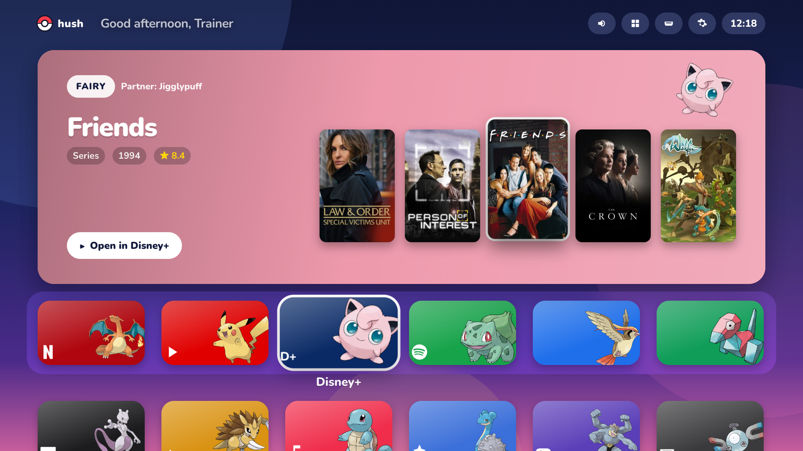

# Pokédex TV

A TV home screen where every app has a Pokémon partner.

Netflix is Charizard, YouTube is Pikachu, Spotify is Bulbasaur. Focus an app and its partner hops; the card above
shows what is popular on that service where you live (TMDB), the news or the markets, and after two minutes a wild
Pokémon appears as the screensaver. One HTML file, no framework, built for a TV remote and a TV GPU.

Runs on Samsung (Tizen 2017+), LG (webOS) and Android TV / Google TV. It is an app you open (TVs do not let anything
replace their home screen); on Android TV it offers itself as the home app.


30-second demo as [mp4](docs/video/pokedex-tv-demo.mp4). Recorded in a desktop browser; the TV build is flatter (see TV mode in the file).



## What is on it

- **Partner tiles.** Only streaming apps that are actually installed on the TV show up, each with its colour and its
  partner. Apps the skin does not know stay out, so the dock stays clean.
- **What's on.** With a TMDB key, a streaming app's card shows five posters of what is popular on it in your country,
  with "Open in Netflix" on OK.
- **News and Markets.** Google News headlines (any RSS feed works) and crypto / currency rates, no keys needed.
- **The TV itself.** HDMI inputs, the TV's own settings and mute, from the home screen.
- **Wild encounters.** After two minutes: "A wild STARYU appeared!", one of the first 151, a new one every minute.

## Install

Grab the packages from the latest release, or build them (`python3 tizen/build.py && python3 tizen/sign.py`,
`python3 webos/build.py`, `bash android/build.sh`; GitHub Actions builds all three on every push).

**Samsung (2017–2022, Tizen 3–6.5):** on the TV open *Apps*, type `1 2 3 4 5`, turn *Developer mode* on with your
computer's IP as *Host PC IP*, restart the TV. Then `python3 tizen/install.py <TV IP>`. The package is signed with the
Tizen SDK's public test certificate, which these TVs accept. **2023 and newer (Tizen 7+)** need a certificate from your
Samsung account: make one in Tizen Studio's Certificate Manager, then `python3 tizen/build.py --sign <profile>`.

**LG:** install *Developer Mode* from the Content Store, sign in with a free LG developer account, turn *Dev Mode Status*
and *Key Server* on, then `python3 webos/install.py <TV IP>` and type the passphrase the TV shows.

**Android TV / Google TV:** allow *Unknown sources* for your file manager or Downloader, open `Pokedex.apk`. Press Home
and pick Pokédex (Always) to make it the home screen.

## TMDB key (for the posters)

Make a free account at themoviedb.org, copy the **API Key (v3)** from Settings → API, and put it in a local file that is
never committed:

```bash
cp config.example.json config.local.json   # then paste the key into it
```

`tizen/build.py` bakes it into the package. Without a key the cards show the partner alone; you can also type a key on
the TV under Settings.

## On the remote

Arrows move · OK opens · hold OK to rearrange · Back returns to the first app · Up from the dock enters the card
(Left/Right picks a poster), Up again reaches the top buttons: sound, arrange, inputs, settings, clock.

## Credits and legal

Pokémon and Pokémon character names are trademarks of Nintendo, Creatures Inc. and GAME FREAK inc. This is a fan
project, not affiliated with or endorsed by them; it ships no artwork — images are loaded at runtime from
[PokéAPI](https://pokeapi.co). This product uses the TMDB API but is not endorsed or certified by TMDB. News via Google
News RSS through rss2json; rates from CoinGecko and the ECB (Frankfurter). The Samsung and LG installers and the IPK
packer come from [Free My TV](https://github.com/simbasjungles/free-my-tv) (MIT). Code: MIT.
